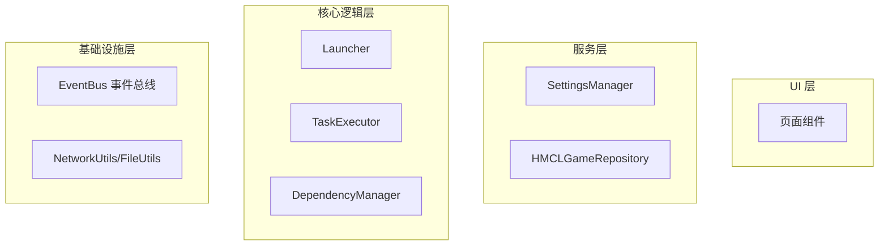
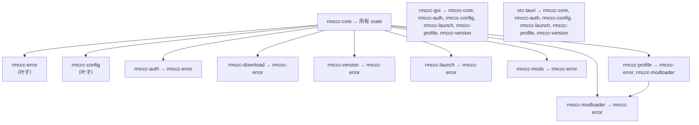
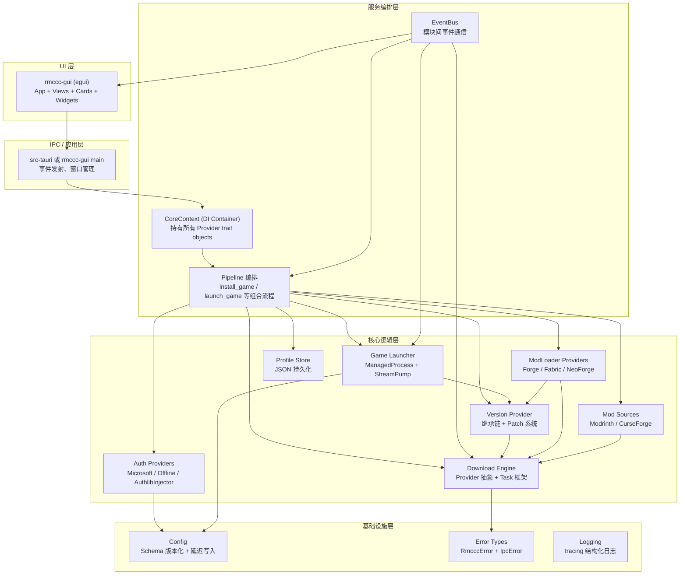

# RMCCC 架构改进计划

> 基于 HMCL v3.0 源码架构分析的对照改进方案  
> 版本：1.0 | 日期：2026-07-29

---

## 第一部分：HMCL 架构导读笔记

### 1.1 HMCL 概览

HMCL（Hello Minecraft! Launcher）v3.0 采用 **Gradle 多模块** 构建，划分为四个顶级模块：

| 模块 | 角色 | 类比 RMCL |
|------|------|-----------|
| **HMCLBoot** | 引导：JavaFX 环境检测、Native 库加载 | `rmccc-gui/src/main.rs` 的初始化部分 |
| **HMCLCore** | 平台无关核心：下载引擎、任务调度、启动流程、事件系统、认证模型 | `rmccc-core` + 所有业务 crate |
| **HMCL** | JavaFX UI、配置管理、主题、平台集成、自更新 | `src-tauri/` + `src/`（当前 SolidJS）或 `rmccc-gui`（egui 迁移） |
| **minecraft/libraries** | 游戏进程内注入库 | 当前无对应（远期功能） |

### 1.2 HMCL 核心设计原则

以下原则是从 12 篇文档中提炼的跨模块通用模式：

#### 原则 1：分层 + 事件驱动架构

HMCL 严格遵循四层架构：UI → 配置/服务 → 核心逻辑 → 基础设施，层间通过 **EventBus 单例** 解耦通信。



**关键要点**：
- UI 不直接调用核心逻辑，通过服务层中转
- 跨模块事件通过 EventBus 发布/订阅，发送者和接收者互不感知
- EventBus 支持 5 级优先级（HIGHEST→LOWEST）、弱引用注册、`Event.Result` 返回值传递

#### 原则 2：Task 框架 —— 一切皆为 Task

HMCL 的核心基础设施是 [`Task<T>`](https://github.com/HMCL-dev/HMCL/blob/main/HMCLCore/src/main/java/org/jackhuang/hmcl/task/Task.java)，所有异步操作（下载、安装、启动）都封装为 Task：

```
Task 特性：
├── 状态机：READY → RUNNING → SUCCEEDED / FAILED / CANCELLED
├── 进度传播：progress → 自动绑定子Task进度
├── 依赖图：getDependencies() / getDependents() 构建 DAG
├── 组合子：allOf / runSequentially / thenApplyAsync / whenComplete
├── 监听器：TaskListener (onStart / onProgress / onFinish / onFailed)
└── 执行器：TaskExecutor (start / cancel / test)
```

**关键要点**：
- `Schedulers.defaultScheduler()` / `ioScheduler()` 统一线程池
- `Task.progress` 属性支持父子绑定
- 所有长时间操作通过 Task 暴露进度，UI 只需观察 Task 状态

#### 原则 3：Trait/Interface 隔离 —— 策略模式 + 工厂模式

HMCL 大量使用接口定义契约，通过工厂模式创建实现：

| 接口 | 实现类 | 模式 |
|------|--------|------|
| `Account` | `MicrosoftAccount`, `OfflineAccount`, `AuthlibInjectorAccount` | Strategy |
| `AccountFactory` | `MicrosoftAccountFactory`, `OfflineAccountFactory` | Factory |
| `DownloadProvider` | `MojangDownloadProvider`, `BMCLAPIDownloadProvider`, `AutoDownloadProvider` | Strategy + Decorator |
| `VersionList<T>` | `GameVersionList`, `ForgeVersionList`, `FabricVersionList` | Template Method |
| `InstallTask` | `ForgeInstallTask`, `FabricInstallTask`, `NeoForgeInstallTask` | Strategy |
| `RemoteAddonRepository` | `CurseForgeRemoteAddonRepository`, `ModrinthRemoteAddonRepository` | Strategy |

**关键要点**：
- 新增下载源只需实现 `DownloadProvider` 接口
- 新增 Modloader 只需实现 `VersionList` + `InstallTask`
- 通过 `LibraryAnalyzer` 自动检测已安装的 Modloader 类型

#### 原则 4：补丁/继承模型 —— 不可变 + 增量修改

版本管理采用 **继承链 + Patch 注入** 模型：

```
1.20.4-forge-49.0.0
  ├── inheritsFrom: 1.20.4
  │     └── inheritsFrom: (无，root)
  └── patches: [ { id: "forge", version: "49.0.0" } ]
```

`resolve()` 合并策略：
- libraries：叠加
- arguments：合并（子覆盖父）
- mainClass：子覆盖父
- assetIndex：子覆盖父

**关键要点**：
- 原始 JSON 永不修改，所有变更通过 patches 追加
- 支持回滚：删除 patch 即可恢复到父版本
- `Resolved` 视图区分 `launchManifest`（启动用）和 `standaloneManifest`（编辑用）

#### 原则 5：配置的 Schema 版本化 + 延迟写入

`SettingsManager` 通过 `$schema` URI 实现配置文件向前兼容：

```
配置文件加载流程：
读取 JSON → 检查 $schema → 比较版本 → 确定兼容状态 →
  READ_WRITE（完全兼容）/ READ_ONLY（只读）/ INVALID（回退默认）
```

`FileSaver` 提供防抖写盘：
```
属性变更 → 通知 Listener → FileSaver.save() → 延迟调度 → 实际写盘
```

#### 原则 6：导航栈 + Decorator 模式

UI 导航使用 `Navigator` 栈结构，`DecoratorController` 管理窗口装饰：
- `Controllers` 作为 Facade 统一 UI 入口
- `Lazy<T>` 延迟页面创建
- `DecoratorAnimatedPage` 提供页面过渡动画
- `@FXThread` 注解标记 UI 线程约束

#### 原则 7：双进程自更新

更新流程使用经典的"双进程替换"模式：
```
旧进程 → 下载 new.jar → 保存配置 → 启动 java -jar new.jar --apply-to old.jar
  → 退出
新进程 → 复制可执行头 → 覆盖旧 JAR → 正常启动
```

---

## 第二部分：当前代码库全量审计报告

### 2.1 目录结构与模块依赖拓扑

```
RMCL/
├── crates/
│   ├── rmccc-error/          # 叶子：统一错误类型
│   ├── rmccc-config/         # 叶子：配置 + 路径 + 日志
│   ├── rmccc-auth/           # 认证：Microsoft OAuth2 + 离线
│   ├── rmccc-download/       # 下载引擎
│   ├── rmccc-version/        # 版本管理
│   ├── rmccc-launch/         # 启动模块
│   ├── rmccc-modloader/      # Modloader 安装（stub）
│   ├── rmccc-mods/           # Mod 管理（stub：仅数据类型）
│   ├── rmccc-profile/        # Profile 管理
│   ├── rmccc-core/           # 编排层 + DI 容器（占位）
│   └── rmccc-gui/            # egui 原生 GUI（迁移中）
├── src-tauri/                # Tauri 2.x 应用层
│   └── src/
│       ├── main.rs
│       ├── state.rs
│       ├── events.rs
│       └── commands/         # IPC 命令处理器
└── src/                      # SolidJS 前端
    ├── routes/
    ├── components/
    ├── ipc/
    └── styles/
```

### 实际依赖拓扑（通过 Cargo.toml 确认）



### 2.2 循环引用分析

**结论：当前代码库无循环引用。** 依赖关系为严格的 DAG，顶层为 `rmccc-core`、`rmccc-gui`、`src-tauri`，底层为 `rmccc-error`、`rmccc-config`。

但存在 **隐含的架构违规**：
- `rmccc-profile` 直接依赖 `rmccc-modloader`（`Profile.mod_loader: Option<ModLoaderConfig>` 引用了 `rmccc_modloader::ModLoaderType`），这违反了"叶子 crate 不依赖业务 crate"的意图。如果严格按照 `ARCHITECTURE.md` 的设计，`rmccc-profile` 不应直接依赖 `rmccc-modloader`。

### 2.3 耦合点识别

| 位置 | 耦合类型 | 严重程度 | 描述 |
|------|----------|----------|------|
| `rmccc-gui/src/state.rs` | God Object | 🔴 严重 | 1004 行单文件，承载 Auth + Profiles + Versions + Launch + Settings + Toast 所有状态 |
| `AppState::new()` | 硬编码初始化 | 🔴 严重 | 直接创建 `reqwest::Client`、`TokenVault`、`CoreContext`，无依赖注入 |
| `launch_start` 命令 | 跨层直接调用 | 🟡 中等 | Tauri command 直接创建 `MojangVersionProvider` 和调用 `find_java` |
| `spawn_*` 方法 | 重复模式 | 🟡 中等 | 每个 `spawn_*` 方法重复 `tx.clone() + state.runtime.spawn` 模式 |
| `auth_get_session` | 重复代码 | 🟡 中等 | Token 刷新逻辑在 `auth.rs` 和 `state.rs::spawn_load_session` 中各实现一次 |
| `Profile` 到 `ModLoaderConfig` | 跨 crate 依赖 | 🟢 低 | `rmccc-profile` → `rmccc-modloader` 直接类型引用 |

### 2.4 核心业务流实现方式分析

| 业务流 | 当前实现 | HMCL 方式 | 差距 |
|--------|----------|-----------|------|
| 登录 | `MicrosoftAuthProvider::authenticate()` 阻塞轮询 | `OAuthServer` 本地 HTTP 回调 + 异步 Task | 无 OAuth 回调服务器，轮询体验差 |
| 下载 | `ConcurrentDownloadManager` 直接 `tokio::spawn` | `Task + TaskExecutor` 框架 | 无任务 DAG、无组合子、无统一进度传播 |
| 安装版本 | `version_install` IPC → 直接下载 clients/libraries/assets | `DefaultGameBuilder.buildAsync()` 编排安装任务树 | 无任务编排、无回滚机制 |
| 启动游戏 | `launch_start` 单体函数（200+ 行） | `DefaultLauncher.launch()` + `ManagedProcess` | 无 ManagedProcess 抽象、无 StreamPump/ExitWaiter |
| 版本管理 | `MojangVersionProvider` 直接返回 | `GameRepository` + `resolve()` 继承链 | 无继承链、无 patch 系统、无多视图 |
| Modloader 安装 | 接口已定义，实现为空 | `installLibraryAsync()` → `InstallTask` | 实现完全缺失 |

### 2.5 技术债务清单

#### 🔴 P0（阻塞性 —— 必须立即修复）

| # | 债务 | 位置 | 影响 |
|---|------|------|------|
| P0-1 | **God Object：`AppState`** | `crates/rmccc-gui/src/state.rs` (1004行) | 单一文件承载全部 UI 状态，新增功能必须修改此文件，导致合并冲突和测试困难 |
| P0-2 | **双 GUI 并存** | `src-tauri/`（SolidJS）vs `crates/rmccc-gui/`（egui） | 两套 GUI 并行开发，架构不同步，维护成本翻倍 |
| P0-3 | **`CoreContext` 为假 DI 容器** | `crates/rmccc-core/src/lib.rs` (57行) | 不持有 trait object，所有 provider 在调用点临时创建，无法替换实现 |
| P0-4 | **modloader 实现为 stub** | `crates/rmccc-modloader/src/{forge,fabric,neoforge}.rs` | Phase 3 无法验收 |

#### 🟡 P1（高风险 —— 本 Phase 内修复）

| # | 债务 | 位置 | 影响 |
|---|------|------|------|
| P1-1 | **版本管理无继承链** | `crates/rmccc-version/` | 无法正确解析 Forge/Fabric 版本 |
| P1-2 | **下载模块无 Provider 抽象** | `crates/rmccc-download/src/lib.rs` | 无法切换下载源/镜像 |
| P1-3 | **无 Task 框架** | 全局 | 无进度聚合、无任务依赖图、无取消传播 |
| P1-4 | **启动流程为单体函数** | `src-tauri/src/commands/launch.rs` (200+行) | 无法复用、难以测试、无 ManagedProcess 抽象 |
| P1-5 | **Token 刷新逻辑重复** | `auth.rs` + `state.rs` | 两处实现相同逻辑，一致性风险 |
| P1-6 | **配置无 Schema 版本化** | `rmccc-config` | 配置文件格式变更时无法自动迁移 |

#### 🟢 P2（中风险 —— 下个 Phase 修复）

| # | 债务 | 位置 | 影响 |
|---|------|------|------|
| P2-1 | **mods crate 仅有数据类型** | `crates/rmccc-mods/src/lib.rs` | Modrinth/CurseForge API 未实现 |
| P2-2 | **无事件总线** | 全局 | 模块间通信依赖直接调用 |
| P2-3 | **无自动更新** | — | tauri-plugin-updater 已引入但未配置 |
| P2-4 | **缺少集成测试** | 全局 | 无 wiremock 模拟 Mojang API |
| P2-5 | **前端类型手动维护** | `src/ipc/api.ts` | ts-rs 已引入但未在类型生成中使用 |

### 2.6 与 ARCHITECTURE.md 设计文档的偏差

| ARCHITECTURE.md 描述 | 实际实现 | 偏差 |
|----------------------|----------|------|
| `rmccc-core` 为 Pipeline 编排 + DI 容器 | 仅 re-export + 3 字段 struct | DI 容器未实现 |
| `AuthProvider` trait | ✅ 已实现 | 一致 |
| `VersionProvider` trait | ✅ 已实现 | 一致 |
| `ModLoaderProvider` trait | ✅ 已实现接口，实现为 stub | 接口一致，实现缺失 |
| `ModSource` trait | ✅ 已实现接口，实现为 stub | 接口一致，实现缺失 |
| `DownloadManager` trait | 未实现 | `ConcurrentDownloadManager` 无 trait 抽象 |
| 独立 `rmccc-gui` crate（egui） | ✅ 存在 | 但迁移未完成 |
| ts-rs 类型自动生成 | 未使用 | 前端类型手动定义 |
| IPC 事件系统常量 | ✅ `events.rs` 已定义 | 一致 |
| `ThrottledEmitter` | ✅ 已实现 | 一致 |

---

## 第三部分：目标架构蓝图

### 3.1 愿景

将 RMCCC 改造为与 HMCL 设计哲学一致的 **高度模块化、可扩展、事件驱动** 的 Minecraft 启动器。核心改造方向：

1. **真正的 DI 容器**：`CoreContext` 持有所有 trait object，支持实现替换和测试 mock
2. **Task 框架**：构建类似 HMCL 的 Task/TaskExecutor 系统，统一异步操作的生命周期管理
3. **事件总线**：引入 EventBus 模式解耦模块间通信
4. **版本继承模型**：实现 `inheritsFrom` + `patches` 版本管理
5. **DownloadProvider 抽象**：支持多下载源和自动镜像选择
6. **ManagedProcess**：封装游戏进程的完整生命周期
7. **状态管理拆分**：按领域拆分 AppState
8. **配置 Schema 版本化**：向前兼容的配置迁移
9. **统一 GUI 方案**：完成 egui 迁移，移除 Tauri+SolidJS

### 3.2 目标架构图



### 3.3 核心设计决策

| 决策 | 选择 | 对应 HMCL 模式 |
|------|------|----------------|
| DI 容器 | `CoreContext` 持有 `HashMap<TypeId, Box<dyn Any>>` 或按领域 struct | `SettingsManager` 集中管理 |
| Task 框架 | `Task<T>` trait + `TaskExecutor` struct + `Scheduler` | 直接对应 `Task.java` + `TaskExecutor.java` |
| EventBus | `EventBus` 单例 + `ClassValue` 替代方案（Rust 用 enum + channel） | 直接对应 `EventBus.java` |
| 版本管理 | `inheritsFrom` + `patches` + `resolve()` | 直接对应 `GameInstanceManifest.Resolved` |
| 下载源 | `DownloadProvider` trait + `MirrorProvider` + `AutoProvider` | 直接对应 `DownloadProvider.java` |
| 进程管理 | `ManagedProcess` struct + `StreamPump` + `ExitWaiter` | 直接对应 `ManagedProcess.java` |
| 配置 | `JsonSchemaVersioned<T>` + `DebouncedWriter` | 直接对应 `JsonSettingFile` + `FileSaver` |
| 状态管理 | Domain Stores: `AuthStore`, `ProfileStore`, `VersionStore`, `LaunchStore`, `SettingsStore` | 对应 HMCL 中各 Settings 子模块 |

---

## 第四部分：逐模块改造方案

### 4.1 `rmccc-error` —— 错误码体系强化

**现状**：`RmcccError` 枚举 19 个变体，`IpcError` 转换覆盖较好。但缺少结构化错误上下文。

**改造目标**：增加错误上下文（source location, span, suggestion），对标 HMCL 的异常体系。

**关键改进**：

```rust
// 新增：WrappedError 带上下文
pub struct ErrorContext {
    pub operation: &'static str,  // "fetch_versions", "download_asset"
    pub suggestion: Option<&'static str>,  // "Check your network connection"
    pub span: Option<tracing::Span>,
}

// 新增：错误码注册表
pub static ERROR_REGISTRY: Lazy<HashMap<ErrorCode, ErrorMeta>> = ...;
```

**优先级**：P1 | **依赖**：无 | **风险**：低（增量添加，不破坏现有接口）

---

### 4.2 `rmccc-config` —— Schema 版本化 + 延迟写入

**现状差距**：
- `AppConfig` 是扁平 struct，无 schema 版本标识
- `save()` 同步写盘，高频写入时性能差
- 无配置文件迁移支持

**改造目标**：

| 功能 | HMCL 实现 | RMCL 实现 |
|------|-----------|-----------|
| Schema 版本化 | `$schema` URI + `JsonSchema` 验证器 | `ConfigVersion` 枚举 + `ConfigMigrator` |
| 延迟写入 | `FileSaver` 防抖 | `DebouncedWriter`（tokio timer 实现） |
| 配置迁移 | `LegacyConfigMigrator` + `MigrationReceipt` | `ConfigMigrator::migrate()` |
| 属性绑定 | `SettingProperty` + JavaFX Binding | 通过 EventBus 事件通知变更 |

**关键接口**：

```rust
/// 版本化的配置文件包装器
pub struct VersionedConfig<T: Serialize + DeserializeOwned> {
    pub version: u32,
    pub data: T,
}

/// 防抖写盘器
pub struct DebouncedWriter {
    tx: mpsc::UnboundedSender<(PathBuf, String)>,
}

impl DebouncedWriter {
    pub fn new(debounce: Duration) -> Self;
    pub fn schedule_write(&self, path: PathBuf, content: String);
    pub async fn flush(&self);
}

/// 配置迁移器
pub trait ConfigMigrator {
    fn source_version(&self) -> u32;
    fn target_version(&self) -> u32;
    fn migrate(&self, raw_json: serde_json::Value) -> Result<serde_json::Value>;
}
```

**集成步骤**：
1. 新增 `crates/rmccc-config/src/versioned.rs` 和 `crates/rmccc-config/src/writer.rs`
2. 修改 `AppConfig::load/save` 包含 version 字段
3. 在 `CoreContext::new` 中初始化 `DebouncedWriter`
4. 应用退出时调用 `flush()`

**优先级**：P1 | **依赖**：无 | **风险**：低

---

### 4.3 `rmccc-core` —— 真正的 DI 容器 + Pipeline 编排

**现状差距**：
- `CoreContext` 仅 57 行，不持有任何 trait object
- 无 pipeline 编排函数
- provider 在调用点临时创建，无法替换/模拟

**改造目标**：对标 HMCL 的 `SettingsManager`（配置） + `Controllers`（编排）

```rust
/// 新的 CoreContext —— 真正的 DI 容器
pub struct CoreContext {
    // 基础设施
    pub config: rmccc_config::AppConfig,
    pub event_bus: Arc<EventBus>,
    pub task_scheduler: Arc<TaskScheduler>,

    // Provider 注册表（trait object）
    pub auth_provider: Box<dyn AuthProvider>,
    pub version_provider: Box<dyn VersionProvider>,
    pub download_provider: Box<dyn DownloadProvider>,
    pub mod_loader_providers: HashMap<ModLoaderType, Box<dyn ModLoaderProvider>>,
    pub mod_sources: HashMap<String, Box<dyn ModSource>>,

    // 管理器
    pub profile_store: rmccc_profile::ProfileStore,
    pub download_manager: Arc<dyn DownloadManager>,
}

impl CoreContext {
    /// Builder 模式构建（支持替换任意 Provider）
    pub fn builder() -> CoreContextBuilder;

    /// 安装游戏版本（pipeline）
    pub async fn install_game(
        &self,
        profile_id: &str,
        version_id: &str,
        progress: ProgressCallback,
    ) -> Result<()>;

    /// 启动游戏（pipeline）
    pub async fn launch_game(
        &self,
        profile_id: &str,
        output_callback: OutputCallback,
    ) -> Result<ManagedProcess>;
}
```

**集成步骤**：
1. 新增 `crates/rmccc-core/src/context.rs` 实现 `CoreContext` 和 `CoreContextBuilder`
2. 新增 `crates/rmccc-core/src/pipeline.rs` 实现编排函数
3. 迁移 `src-tauri/src/state.rs` 和 `rmccc-gui/src/state.rs` 使用新的 `CoreContext`
4. 废弃旧的 `CoreContext::new()`（保留兼容性别名）

**优先级**：P0 | **依赖**：所有其他改造 | **风险**：高（影响面大）

---

### 4.4 `rmccc-download` —— Provider 抽象 + DownloadManager trait

**现状差距**：
- `ConcurrentDownloadManager` 无 trait 抽象
- 无下载源选择机制
- 缓存仅基于 SHA1，无 ETag 支持

**改造目标**：

```rust
/// 下载源接口（对标 HMCL DownloadProvider）
#[async_trait]
pub trait DownloadProvider: Send + Sync {
    /// 注入/转换 URL（例如 Mojang URL → BMCLAPI URL）
    fn inject_url(&self, url: &str) -> String;

    /// 获取版本清单下载 URL
    fn version_manifest_url(&self) -> &str;

    /// 获取资源对象候选 URL 列表（主源 + 备用镜像）
    fn asset_candidates(&self, hash: &str) -> Vec<String>;

    /// 最大并发连接数
    fn concurrency(&self) -> usize;
}

// 实现：
// - MojangDownloadProvider（官方源）
// - BmclApiDownloadProvider（BMCLAPI 国内镜像）
// - AutoDownloadProvider（测速自动选择）

/// DownloadManager trait（已定义于 ARCHITECTURE.md §3.2）
#[async_trait]
pub trait DownloadManager: Send + Sync {
    async fn download_batch(
        &self,
        items: Vec<DownloadItem>,
        progress: ProgressCallback,
    ) -> Result<DownloadHandle>;
    async fn cancel_batch(&self, handle: &DownloadHandle) -> Result<()>;
    async fn cancel_file(&self, handle: &DownloadHandle, item_id: &str) -> Result<()>;
    async fn pause(&self, handle: &DownloadHandle) -> Result<()>;
    async fn resume(&self, handle: &DownloadHandle) -> Result<()>;
}
```

**集成步骤**：
1. 新增 `crates/rmccc-download/src/provider.rs` 定义 `DownloadProvider` trait
2. 新增 `crates/rmccc-download/src/providers/` 各实现
3. 新增 `crates/rmccc-download/src/cache.rs` ETag 缓存支持
4. 让 `ConcurrentDownloadManager` 实现 `DownloadManager` trait
5. 在 `CoreContext` 中注册 `DownloadProvider`

**优先级**：P1 | **依赖**：rmccc-core 改造 | **风险**：中

---

### 4.5 `rmccc-version` —— 版本继承链 + Patch 系统

**现状差距**：
- `GameVersion` 是扁平 struct，无继承链字段
- 无 `inheritsFrom` 解析
- 无 `resolve()` 合并逻辑
- 无 patch 系统

**改造目标**：对标 HMCL 的 `GameInstanceManifest` + `resolve()`

```rust
/// 版本清单（对标 HMCL GameInstanceManifest Record）
pub struct GameVersion {
    pub id: String,
    pub inherits_from: Option<String>,       // 新增
    pub patches: Vec<GamePatch>,             // 新增
    pub main_class: String,
    pub asset_index: AssetIndex,
    pub libraries: Vec<Library>,
    pub arguments: GameArguments,
    pub java_version: Option<JavaRequirement>,
    pub release_type: ReleaseType,
    // ... 其他字段
}

/// 版本补丁（Modloader 注入）
pub struct GamePatch {
    pub id: String,          // "forge", "fabric" 等
    pub version: String,
}

/// 解析后的完整视图
pub struct ResolvedVersion {
    pub launch_manifest: GameVersion,    // 启动用（完全展开）
    pub standalone_manifest: GameVersion, // 编辑用（保留 patches）
}

/// 版本仓库 trait
#[async_trait]
pub trait VersionRepository: Send + Sync {
    async fn resolve(&self, version_id: &str) -> Result<ResolvedVersion>;
    async fn get_version_json(&self, version_id: &str) -> Result<GameVersion>;
    fn get_instance_jar(&self, version_id: &str) -> PathBuf;
    fn get_library_path(&self, library: &Library) -> PathBuf;
    fn get_asset_path(&self, hash: &str) -> PathBuf;
}
```

**合并策略**（`resolve()`）：
1. 沿 `inherits_from` 链向上，收集所有 ancestors 的 libraries、arguments
2. 子版本覆盖父版本的同名字段
3. 收集所有 patches 并按顺序应用
4. 生成 `launch_manifest`（全展开）和 `standalone_manifest`（保留 patches 信息）

**集成步骤**：
1. 修改 `types.rs` 中 `GameVersion` 增加 `inherits_from`、`patches` 字段
2. 新增 `crates/rmccc-version/src/repository.rs` 实现 `resolve()`
3. 新增 `crates/rmccc-version/src/patch.rs` 实现 patch 解析
4. 修改 `MojangVersionProvider::fetch_version()` 正确解析继承链
5. 更新 `launch_start` 使用 `ResolvedVersion::launch_manifest`

**优先级**：P0 | **依赖**：无 | **风险**：中（需仔细处理继承链边角情况）

---

### 4.6 `rmccc-launch` —— ManagedProcess + 进程监控

**现状差距**：
- `launch_start` 是 200+ 行单体函数
- 无 `ManagedProcess` 抽象
- 无 `StreamPump` / `ExitWaiter`
- 进程监控分散在 command 中

**改造目标**：对标 HMCL 的 `DefaultLauncher` + `ManagedProcess`

```rust
/// 受控游戏进程
pub struct ManagedProcess {
    pub profile_id: String,
    pub child: tokio::process::Child,
    pub command_line: Vec<String>,
    pub lines: Arc<Mutex<Vec<String>>>,
    pub stdout_handle: JoinHandle<()>,
    pub stderr_handle: JoinHandle<()>,
    pub exit_handle: JoinHandle<ExitStatus>,
}

impl ManagedProcess {
    /// 启动 stdout/stderr 流泵和退出监控
    pub fn start_monitors(
        child: tokio::process::Child,
        command_line: Vec<String>,
        on_output: impl Fn(String, bool) + Send + 'static,
        on_exit: impl FnOnce(i32) + Send + 'static,
    ) -> Self;

    /// 获取最近 N 行日志
    pub fn recent_lines(&self, n: usize) -> Vec<String>;

    /// 终止进程
    pub async fn kill(&self) -> Result<()>;

    /// 进程是否仍在运行
    pub fn is_running(&self) -> bool;
}

/// 游戏启动器
pub struct GameLauncher {
    java_path: PathBuf,
    version: ResolvedVersion,
    auth_info: AuthInfo,
    options: LaunchOptions,
}

impl GameLauncher {
    pub fn new(/* ... */) -> Self;
    pub fn generate_command_line(&self) -> Result<Vec<String>>;
    pub fn build_response_file(&self, dir: &Path) -> Result<PathBuf>;
    pub fn decompress_natives(&self, dir: &Path) -> Result<()>;
    pub async fn launch(
        self,
        on_output: impl Fn(String, bool) + Send + 'static,
        on_exit: impl FnOnce(i32) + Send + 'static,
    ) -> Result<ManagedProcess>;
}
```

**集成步骤**：
1. 新增 `crates/rmccc-launch/src/managed.rs` 实现 `ManagedProcess`
2. 新增 `crates/rmccc-launch/src/launcher.rs` 实现 `GameLauncher`
3. 重构 `launch_start` IPC command 使用 `GameLauncher`
4. 废弃 `process.rs` 中的旧函数（保留兼容别名）

**优先级**：P1 | **依赖**：rmccc-version 改造 | **风险**：中

---

### 4.7 `rmccc-auth` —— OAuth 回调服务器 + 多账户管理

**现状差距**：
- 仅支持 device code flow（轮询），无传统 OAuth 回调
- 无 `AuthlibInjector` 外置登录
- 单账户模式

**改造目标**：

| 功能 | HMCL | RMCL 目标 |
|------|------|-----------|
| Microsoft 登录 | `OAuthServer` 本地回调 | `OAuthCallbackServer` + device code 双模式 |
| Token 刷新 | `Account.refresh()` | `AuthProvider::refresh()` ✅ 已实现 |
| 外置登录 | `AuthlibInjectorAccount` | `AuthlibInjectorProvider`（远期） |
| 多账户 | `Accounts` ObservableList | `AccountStore` 管理多账户 |
| 持久化 | `ProtectedPayload` 加密 | `TokenVault` ✅ 已实现 |

**关键新接口**：

```rust
/// OAuth 回调服务器
pub struct OAuthCallbackServer {
    port: u16,
    shutdown_tx: tokio::sync::oneshot::Sender<()>,
}

impl OAuthCallbackServer {
    pub async fn start() -> Result<(Self, String)>;  // 返回 (server, redirect_uri)
    pub async fn wait_for_code(self) -> Result<String>;  // 阻塞直到收到 code
}
```

**优先级**：P2 | **依赖**：无 | **风险**：低

---

### 4.8 `rmccc-modloader` —— 实现所有 InstallTask

**现状差距**：Fabric、Forge、NeoForge 实现为空 stub。

**改造目标**：对标 HMCL 的 `installLibraryAsync()` 模式

**各 Modloader 实现计划**：

| Modloader | 实现方式 | HMCL 参考 |
|-----------|----------|-----------|
| **Fabric** | Fabric Meta API → 下载 loader JAR → 生成 `GamePatch` | `FabricInstallTask` |
| **Forge (新版)** | 下载 Installer JAR → 解析 `install_profile.json` → 下载 Processor libraries → 执行 Processor | `ForgeNewInstallTask` |
| **Forge (旧版)** | 解析 `version.json` → 直接作为 `GamePatch` 注入 | `ForgeOldInstallTask` |
| **NeoForge** | 类似 Forge 新版流程 | `NeoForgeInstallTask` |

**Fabric 安装流程**（最简实现，优先完成）：

```rust
impl ModLoaderProvider for FabricInstaller {
    async fn list_versions(&self, game_version: &str) -> Result<Vec<LoaderVersion>> {
        // GET https://meta.fabricmc.net/v2/versions/loader
    }

    async fn install(
        &self,
        game_version: &str,
        loader_version: &str,
        game_dir: &Path,
        java_path: &Path,
    ) -> Result<String> {
        // 1. 获取 intermediary mappings
        // 2. 下载 fabric-loader-{version}.jar
        // 3. 生成 GamePatch { id: "fabric", version }
        // 4. 返回版本 ID
    }
}
```

**优先级**：P0 | **依赖**：rmccc-version 改造完成 | **风险**：Forge 安装流程复杂

---

### 4.9 `rmccc-mods` —— 实现 Modrinth/CurseForge API

**现状差距**：仅有数据类型定义，无 API 调用实现。

**改造目标**：

```rust
// Modrinth API 实现
pub struct ModrinthSource {
    client: reqwest::Client,
    base_url: String,  // https://api.modrinth.com/v2
}

#[async_trait]
impl ModSource for ModrinthSource {
    async fn search(&self, query: &ModSearchQuery) -> Result<ModSearchResult> {
        // GET /search?query=...&facets=[...]
    }
    async fn list_versions(&self, mod_id: &str) -> Result<Vec<ModVersion>>;
    async fn get_download_url(&self, version_id: &str) -> Result<String>;
}
```

**优先级**：P2 | **依赖**：rmccc-download Provider 抽象 | **风险**：低（REST API 调用，无复杂逻辑）

---

### 4.10 `rmccc-gui` —— 状态管理拆分 + 事件总线

**现状差距**：
- `state.rs` 1004 行 God Object
- `AppState` 直接包含所有域的状态
- 无事件总线，仅通过 `mpsc` channel 传递 `UiEvent`

**改造目标**：按领域拆分状态，引入 EventBus 解耦

#### 4.10.1 状态拆分

```
crates/rmccc-gui/src/state/
├── mod.rs              # AppState 结构体（聚合各 Store）
├── auth_store.rs       # AuthStore: session, auth_loading
├── profile_store.rs    # ProfileStore: profiles, selected_id, create modal
├── version_store.rs    # VersionStore: versions, filter, installing
├── launch_store.rs     # LaunchStore: launching, running_profiles, game_log
├── settings_store.rs   # SettingsStore: config, java installations
└── toast_store.rs      # ToastStore: toasts
```

每个 Store 都是独立的 struct，有自己的 event 处理和 spawn 方法。

#### 4.10.2 事件总线

```rust
use std::any::Any;
use std::collections::HashMap;
use tokio::sync::broadcast;

pub struct EventBus {
    senders: HashMap<TypeId, Box<dyn Any + Send + Sync>>,
}

impl EventBus {
    pub fn new() -> Self;

    /// 注册事件通道
    pub fn register<E: Clone + Send + 'static>(&mut self, capacity: usize);

    /// 获取发送器
    pub fn sender<E: Clone + Send + 'static>(&self) -> broadcast::Sender<E>;

    /// 订阅事件
    pub fn subscribe<E: Clone + Send + 'static>(&self) -> broadcast::Receiver<E>;
}
```

#### 4.10.3 迁移路径

当前 RMCL 正在从 Tauri+SolidJS 迁移到 egui 原生 GUI。建议完成以下步骤：

1. **Phase A**：完成 egui 迁移，达到与 SolidJS 功能等价
2. **Phase B**：移除 `src-tauri/` 和 `src/`（SolidJS 前端）
3. **Phase C**：在纯 Rust GUI 上执行状态拆分和 EventBus 引入

**优先级**：状态拆分 P0，EventBus P1 | **依赖**：CoreContext 改造 | **风险**：高（影响所有 UI）

---

### 4.11 Task 框架 —— 新建基础设施

**现状**：无 Task 框架，所有异步操作直接使用 `tokio::spawn`。

**改造目标**：构建对标 HMCL 的 Task 框架

```rust
/// Task trait —— 所有异步操作的基础抽象
#[async_trait]
pub trait Task: Send + Sync {
    type Output: Send;

    /// 任务名称（显示用）
    fn name(&self) -> &str;

    /// 子任务（依赖的 Tasks）
    fn dependencies(&self) -> Vec<Arc<dyn Task<Output = ()>>> { vec![] }

    /// 执行任务
    async fn execute(&self, ctx: &TaskContext) -> Result<Self::Output>;

    /// 预估总工作量（用于进度条）
    fn estimated_work(&self) -> u64 { 1 }

    /// 当前进度（0..=estimated_work）
    fn progress(&self) -> u64 { 0 }
}

/// 任务执行器
pub struct TaskExecutor {
    scheduler: Arc<TaskScheduler>,
    cancel_token: CancellationToken,
}

impl TaskExecutor {
    /// 启动执行，返回 JoinHandle
    pub fn start<T: Task>(task: T) -> TaskHandle<T::Output>;

    /// 取消执行
    pub fn cancel(&self);
}

/// 任务句柄
pub struct TaskHandle<T> {
    cancel_token: CancellationToken,
    result_rx: oneshot::Receiver<Result<T>>,
    progress_rx: broadcast::Receiver<ProgressUpdate>,
}

/// 任务调度器（全局线程池）
pub struct TaskScheduler {
    io_pool: tokio::runtime::Handle,
    compute_pool: tokio::runtime::Handle,
}

/// 任务组合子
impl Task {
    /// 并行执行所有子任务
    fn all_of(tasks: Vec<Arc<dyn Task>>) -> JoinTask;

    /// 顺序执行
    fn sequentially(tasks: Vec<Arc<dyn Task>>) -> SequentialTask;

    /// 链式转换
    fn then<F, U>(self, f: F) -> ThenTask<Self, F, U>;
}
```

**集成步骤**：
1. 新建 `crates/rmccc-task/` crate
2. 实现 `Task` trait + `TaskExecutor` + `TaskScheduler`
3. 迁移 `rmccc-download` 内下载操作为 `DownloadTask`
4. 迁移 `rmccc-version` 内版本安装为 `InstallTask`
5. 在 `CoreContext` 中注册 `TaskScheduler`

**优先级**：P1 | **依赖**：无（新 crate） | **风险**：中

---

## 第五部分：演进路线图

### Phase 0：架构基础修复（当前 — 优先执行）

**目标**：建立正确的架构骨架，为后续开发提供坚实基础。

| 里程碑 | 产出 | 可度量成果 |
|--------|------|------------|
| M0.1：CoreContext 改造 | DI 容器持有所有 trait object | 所有 Provider 通过 CoreContext 获取，不再临时创建 |
| M0.2：版本继承链 | `inheritsFrom` + `resolve()` | 正确解析 Forge 1.20.4 的继承链 |
| M0.3：AppState 拆分 | 6 个独立 Store | `state.rs` 从 1004 行拆分为 6 个 < 150 行的模块 |
| M0.4：Modloader 实现 | Fabric 安装可用 | 能通过 UI 安装 Fabric Loader |
| M0.5：去除双 GUI | 移除 `src-tauri/` + `src/` | 代码库只有一个 GUI 实现 |

### Phase 1：基础设施补全

**目标**：Task 框架 + 事件总线 + 下载 Provider 抽象。

| 里程碑 | 产出 | 可度量成果 |
|--------|------|------------|
| M1.1：Task 框架 | `rmccc-task` crate | 所有异步操作通过 Task 执行，带进度和取消 |
| M1.2：EventBus | 全局事件总线 | 模块间无直接调用，通过事件解耦 |
| M1.3：DownloadProvider | Mojang + BMCLAPI 两个源 | 可切换下载源，自动测速 |
| M1.4：ManagedProcess | 进程封装 | 游戏进程完整生命周期管理 |

### Phase 2：功能完善

**目标**：Forge/NeoForge 安装 + Mod 管理 + 配置 Schema 化。

| 里程碑 | 产出 | 可度量成果 |
|--------|------|------------|
| M2.1：Forge 安装 | 新版 Forge Installer 可用 | 能安装 Forge 1.13+ |
| M2.2：NeoForge 安装 | NeoForge Installer 可用 | 能安装 NeoForge 1.20.1+ |
| M2.3：Modrinth API | 搜索 + 安装 Mod | 能从 Modrinth 搜索并安装 Mod |
| M2.4：配置 Schema | 版本化配置 + 自动迁移 | 配置格式变更时无感升级 |

### Phase 3：生产就绪

**目标**：测试覆盖 + 自动更新 + 多平台构建。

| 里程碑 | 产出 | 可度量成果 |
|--------|------|------------|
| M3.1：集成测试 | wiremock 模拟 Mojang API | 关键路径集成测试通过 |
| M3.2：自动更新 | 自更新可用 | 通过 GitHub Release 自动更新 |
| M3.3：体积优化 | `cargo bloat` 审计 | 最终 binary < 10MB |
| M3.4：三平台构建 | Windows/macOS/Linux CI | 三平台构建产物通过测试 |

---

## 第六部分：规范建设建议

### 6.1 命名约定

| 类别 | 约定 | 示例 |
|------|------|------|
| Crate | `rmccc-{domain}` kebab-case | `rmccc-task` |
| Trait | `{Domain}Provider`, `{Domain}Store` | `AuthProvider`, `ProfileStore` |
| Struct (数据) | 名词，无后缀 | `GameVersion`, `AuthSession` |
| Struct (管理器) | `{Domain}Manager` | `DownloadManager` |
| Enum | PascalCase，变体同 | `ReleaseType::Snapshot` |
| 异步函数 | `async fn` 签名 | `async fn fetch_versions()` |
| IPC 命令 | `{domain}_{action}` snake_case | `auth_microsoft_login` |
| 事件名 | `{domain}://{action}` | `download://progress` |

### 6.2 接口契约

每个 Provider trait 必须包含：
1. `///` doc comment 描述职责
2. `# Errors` 说明错误情况
3. 对于 `async fn`，注明是否可取消（通过 `CancellationToken`）
4. 所有 trait 定义在对应 crate 的 `lib.rs` 中 re-export

```rust
/// 认证提供者 trait。
///
/// # Errors
/// - `AuthFailed`: 认证被拒绝
/// - `Network`: 网络错误
/// - `Timeout`: 操作超时
#[async_trait]
pub trait AuthProvider: Send + Sync {
    fn provider_id(&self) -> &str;
    async fn authenticate(&self, progress: Option<&ProgressCallback>) -> Result<AuthSession>;
    async fn refresh(&self, session: &AuthSession) -> Result<AuthSession>;
    async fn validate(&self, session: &AuthSession) -> bool;
}
```

### 6.3 日志标准

| 级别 | 使用场景 | 示例 |
|------|----------|------|
| `ERROR` | 用户可见错误，阻止操作 | `"Failed to load config: {e}"` |
| `WARN` | 降级行为，可恢复 | `"Token refresh failed, using cached session"` |
| `INFO` | 关键操作记录 | `"Profile created: id={id}, name={name}"` |
| `DEBUG` | 调试信息，开发环境 | `"Resolving version chain for {id}"` |
| `TRACE` | 细粒度调试，默认关闭 | `"HTTP request: GET {url}"` |

Span 规范：
- 所有 IPC command 使用 `#[tracing::instrument(skip(state))]`
- 敏感字段使用 `skip` 标记
- 网络请求使用 `trace` span，包含 `method`、`url`、`status` 字段

### 6.4 错误码体系

在现有 `ErrorCode` 枚举基础上补充：

```rust
pub enum ErrorCode {
    // 现有 ...
    // 新增
    VersionNotInstalled,
    VersionIncompatible,
    ModLoaderNotSupported,
    DependencyResolutionFailed,
    InstanceAlreadyRunning,  // 替代 AlreadyRunning
    InstanceLocked,
    ConfigMigrationFailed,
    UpdateCheckFailed,
    UpdateDownloadFailed,
    IntegrityCheckFailed,
}
```

前端根据 `ErrorCode` 决定 UI 行为：
- `NetworkError` / `Timeout` → 显示重试按钮
- `AuthFailed` / `TokenExpired` → 跳转登录页
- `InsufficientDiskSpace` → 显示磁盘清理提示
- `GameCrashed` → 显示崩溃分析面板

### 6.5 测试金字塔落地方案

```
          /\
         /E2E\         5%：关键用户路径（登录→安装→启动）
        /------\
       /集成测试\        15%：wiremock 模拟外部 API
      /----------\
     /  单元测试   \      80%：所有 Provider、Manager、Pipeline
    /--------------\
```

**单元测试规范**：
- 每个 `src/` 文件配 `#[cfg(test)] mod tests`
- Provider 测试使用 `wiremock` 模拟 HTTP
- 关键算法（版本比较、UUID 生成、SHA1 校验）必须 100% 覆盖

**集成测试规范**：
- 放在对应 crate 的 `tests/` 目录
- 使用 `wiremock` 启动本地 HTTP 服务器
- Fixture 数据放在 `tests/fixtures/`
- 每个 API 端点至少一个 happy path + 一个 error case

**E2E 测试规范**：
- 使用 tauri-driver（如果保留 Tauri）或自定义测试框架
- 覆盖：启动器启动 → 离线登录 → 创建 Profile → 安装版本 → 启动游戏

### 6.6 文档同步机制

| 文档 | 更新触发条件 | 负责人 |
|------|-------------|--------|
| `ARCHITECTURE.md` | 任何 crate 新增/删除/合并 | 变更作者 |
| `DEVELOPMENT_PLAN.md` | Phase 完成/新增任务 | Tech Lead |
| `AI_EDITING_RULES.md` | 新规范引入 | Tech Lead |
| `ARCHITECTURE_IMPROVEMENT_PLAN.md`（本文） | 里程碑完成 | Tech Lead |
| 各 crate `lib.rs` top comment | crate 职责变更 | 变更作者 |

### 6.7 Code Review 检查清单

每 PR 必须通过：
- [ ] `cargo check --workspace` 零错误
- [ ] `cargo clippy --workspace -- -D warnings` 零警告
- [ ] `cargo fmt -- --check` 格式正确
- [ ] `cargo test --workspace` 全绿
- [ ] 新增公开 API 有 `///` doc comment
- [ ] 无 `unwrap()` / `expect()`（除非有明确安全注释）
- [ ] 无 `#[allow(dead_code)]` 新增
- [ ] IPC 命令变更同步更新了 `api.ts`（如果保留前端）
- [ ] 架构变更更新了 `ARCHITECTURE.md`

---

## 附录 A：HMCL → RMCL 模式映射速查表

| HMCL 概念 | RMCL 对应 | 状态 |
|-----------|-----------|------|
| `EventBus` | `EventBus` (待实现) | 🔴 未实现 |
| `Task<T>` | `Task` trait (待实现) | 🔴 未实现 |
| `TaskExecutor` | `TaskExecutor` (待实现) | 🔴 未实现 |
| `Schedulers` | `TaskScheduler` (待实现) | 🔴 未实现 |
| `DownloadProvider` | `DownloadProvider` trait (待实现) | 🔴 未实现 |
| `DependencyManager` | `DownloadManager` trait | 🟡 已定义接口，实现未对齐 |
| `GameRepository` | `VersionRepository` trait (待实现) | 🔴 未实现 |
| `GameInstanceManifest` | `GameVersion` | 🟡 缺少 `inheritsFrom` + `patches` |
| `DefaultGameRepository` | — | 🔴 无对应 |
| `HMCLGameRepository` | `CoreContext` (部分) | 🟡 仅部分职责 |
| `Account` + `AccountFactory` | `AuthProvider` trait | 🟢 已实现 |
| `AuthInfo` | `AuthSession` | 🟢 已实现 |
| `OAuthServer` | `OAuthCallbackServer` (待实现) | 🔴 未实现 |
| `Launcher` + `DefaultLauncher` | `GameLauncher` (待实现) | 🔴 未实现 |
| `ManagedProcess` | `ManagedProcess` (待实现) | 🔴 未实现 |
| `StreamPump` | `stdout/stderr reader task` | 🟡 内联实现 |
| `ExitWaiter` | `tokio::spawn` wait loop | 🟡 内联实现 |
| `LaunchOptions` | `LaunchArgBuilder` | 🟢 部分实现 |
| `CommandBuilder` | `LaunchArgBuilder::jvm_args/game_args` | 🟢 已实现 |
| `VersionList<T>` | — | 🔴 未实现 |
| `InstallTask` | `ModLoaderProvider::install()` | 🟡 接口已定义 |
| `LibraryAnalyzer` | — | 🔴 未实现 |
| `RemoteAddonRepository` | `ModSource` trait | 🟡 接口已定义，实现为空 |
| `ModManager` | — | 🔴 未实现 |
| `SettingsManager` | `AppConfig` + `CoreContext` | 🟡 分散在多处 |
| `JsonSettingFile<T>` | `VersionedConfig<T>` (待实现) | 🔴 未实现 |
| `FileSaver` | `DebouncedWriter` (待实现) | 🔴 未实现 |
| `SettingProperty` | (通过 EventBus 替代) | 🔴 未实现 |
| `Controllers` | `CoreContext` (部分) | 🟡 仅部分职责 |
| `Navigator` | 不需要（egui 即时模式） | — |
| `DecoratorController` | 不需要（egui 即时模式） | — |
| `UpdateChecker` | `tauri-plugin-updater` | 🟡 已引入未配置 |

**图例**：🟢 已实现 | 🟡 部分实现 | 🔴 未实现

---

## 附录 B：风险矩阵

| 风险 | 概率 | 影响 | 缓解措施 |
|------|------|------|----------|
| CoreContext 改造破坏现有 IPC 命令 | 中 | 高 | 渐进迁移：保留旧 API 并标记 deprecated，新 API 并行添加 |
| 版本继承链实现不完整 | 中 | 高 | 以 vanilla (无继承) → Fabric → Forge 顺序逐步验证 |
| Forge 新版安装流程过于复杂 | 高 | 中 | 参考 HMCL `ForgeNewInstallTask` 源码，分阶段实现 |
| egui 迁移影响用户体验 | 低 | 中 | 保持功能等价后再切换，灰度发布 |
| 双 GUI 维护成本 | 高 | 中 | 尽快完成 Phase 0 M0.5，只保留 egui |

---

> **本文档应与 [`ARCHITECTURE.md`](ARCHITECTURE.md) 和 [`DEVELOPMENT_PLAN.md`](DEVELOPMENT_PLAN.md) 配合使用。**
> 当本改进计划中的里程碑完成时，应及时更新 `ARCHITECTURE.md` 中的对应章节。
