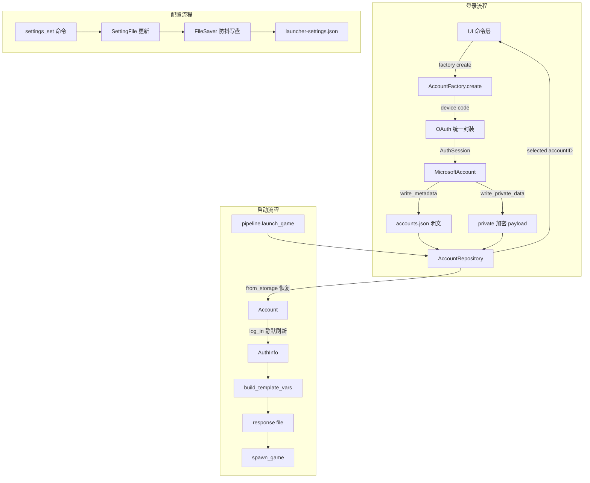

# RMCCC 账户认证与配置持久化 —— 架构分析与重构步骤清单

> 对标对象：HMCL（HMCLCore `auth/` + HMCL `setting/`）
> 原则：使用 HMCL 同款实现方式直接学习，不自行过度创新。所有重构均以 HMCL 成熟模式为蓝本，再落到 Rust 语言与 <10MB 体积红线约束。

---

## 一、当前架构与 HMCL 的差距分析

### 1. 认证模块（rmccc-auth）

| # | 维度 | HMCL 设计 | 当前实现 | 差异与缺陷 |
|---|------|-----------|----------|-----------|
| A1 | 账户标识 | `AccountID`（`account:<uuid>` 前缀化稳定 ID），标识"账户记录"本身，独立于 MC profile ID；支持本地/用户共享两级、跨文件去重（[`AccountID.java`](/Users/chensinuo/Codex/HMCL-main/HMCLCore/src/main/java/org/jackhuang/hmcl/auth/AccountID.java)） | 用 `AuthSession.uuid`（MC profile UUID）直接作文件主键 `accounts/{uuid}.json`（[`vault.rs`](crates/rmccc-auth/src/vault.rs:174)），`active` 指针存 UUID | 混淆"账户记录"与"MC 角色"。同一账户改名/换角色后 UUID 相同但记录语义错位；离线同名账户冲突；`active` 指向已删文件时需兜底（[`vault.rs`](crates/rmccc-auth/src/vault.rs:188)） |
| A2 | 公私数据分离 | `accounts.json` 明文 metadata（type/accountID/profileID/profileName/skin/selected）+ `account-private-data.json` 加密 private data，经 `AccountID` 关联（[`Accounts.java`](/Users/chensinuo/Codex/HMCL-main/HMCL/src/main/java/org/jackhuang/hmcl/setting/Accounts.java:130)） | 整个 `AuthSession`（含 token）整体加密为一个密文文件 | 列出账户必须逐文件解密（[`vault.rs`](crates/rmccc-auth/src/vault.rs:209)）；无法明文展示账户列表；加密粒度过大 |
| A3 | 离线 UUID | `UUID.nameUUIDFromBytes(("OfflinePlayer:" + username))`，UUID v3/MD5（[`OfflineAccountFactory.java`](/Users/chensinuo/Codex/HMCL-main/HMCLCore/src/main/java/org/jackhuang/hmcl/auth/offline/OfflineAccountFactory.java:85)） | `Uuid::new_v5(NAMESPACE_DNS, username)`，UUID v5/SHA-1（[`offline.rs`](crates/rmccc-auth/src/offline.rs:23)） | **一致性缺陷**：与官方/HMCL/其他启动器、服务器白名单、皮肤站完全不一致 |
| A4 | Token 生命周期 | `MicrosoftAccount.logIn()`：`authenticated` 状态 + `notAfter` 检查 + `service.validate()` 远程校验；刷新后**校验 profile id 是否变化**（[`MicrosoftAccount.java`](/Users/chensinuo/Codex/HMCL-main/HMCLCore/src/main/java/org/jackhuang/hmcl/auth/microsoft/MicrosoftAccount.java:78)）；区分 `logIn()`（静默刷新）与 `logInWhenCredentialsExpired()`（浏览器重授权） | `refresh_session_if_needed` 仅按本地 `expires_at` 判断过期才刷新（[`lib.rs`](crates/rmccc-core/src/lib.rs:203)）；刷新后**不校验 uuid 一致性**；刷新失败返回 `None` 沿用旧 token | 无提前刷新窗口；刷新后可能静默绑定到另一账户；刷新失败用户无感但启动必失败；无"凭证过期→重新授权"的完整链路 |
| A5 | 认证结果 | `AuthInfo` 值对象（username/uuid/accessToken/userType/userProperties），离线 `playOffline()` 返回 `USER_TYPE_MSA` + 随机 token（[`OfflineAccount.java`](/Users/chensinuo/Codex/HMCL-main/HMCLCore/src/main/java/org/jackhuang/hmcl/auth/offline/OfflineAccount.java:103)） | 启动时由 pipeline/commands 手工从 `AuthSession` 提取 username/uuid/token/type（[`pipeline.rs`](crates/rmccc-core/src/pipeline.rs:489)）；离线 token 用 `"0"`、type `legacy` | 无统一 `AuthInfo`；离线会话语义与 HMCL（msa+随机 token）不同，可能影响对会话校验敏感的服务器/模组 |
| A6 | 扩展模型 | `AccountFactory<T>`：`create()` 新登录 + `fromStorage(metadata, privateData)` 恢复（[`AccountFactory.java`](/Users/chensinuo/Codex/HMCL-main/HMCLCore/src/main/java/org/jackhuang/hmcl/auth/AccountFactory.java:75)） | 单一 `AuthProvider` trait（authenticate/refresh/validate），无 `fromStorage` 恢复抽象（[`types.rs`](crates/rmccc-auth/src/types.rs:54)）；恢复逻辑散落 vault + 命令层 + pipeline | 新增外置登录（Authlib-Injector）时需同时改 vault、命令层、pipeline，耦合高 |
| A7 | OAuth 抽象 | `OAuth` 统一封装 device + authorization_code 双 flow，`OAuth.Callback` 抽象浏览器/回调/设备码（[`OAuth.java`](/Users/chensinuo/Codex/HMCL-main/HMCLCore/src/main/java/org/jackhuang/hmcl/auth/OAuth.java:38)） | Microsoft 具体逻辑全部内联在 `MicrosoftAuthProvider`，device code 硬编码 | 无复用 OAuth 层；`oauth2` crate 已声明但实际未用（[`Cargo.toml`](crates/rmccc-auth/Cargo.toml:11)），为死依赖，违反体积红线 |
| A8 | 存储职责 | 全局单例 `Accounts` 仓库，统一持有 factory、list、selected、读写（[`Accounts.java`](/Users/chensinuo/Codex/HMCL-main/HMCL/src/main/java/org/jackhuang/hmcl/setting/Accounts.java:65)） | `TokenVault` 同时承担加密 + 单文件 auth.json + 多账户目录 + active 指针；调用点散落且反复 `TokenVault::init(.key)` | 数据访问逻辑重复（[`commands/auth.rs`](src-tauri/src/commands/auth.rs)、[`context.rs`](src-cli/src/context.rs:49)、[`pipeline.rs`](crates/rmccc-core/src/pipeline.rs:492)）；vault 不在 CoreContext 统一管理 |

### 2. 配置持久化（rmccc-config）

| # | 维度 | HMCL 设计 | 当前实现 | 差异与缺陷 |
|---|------|-----------|----------|-----------|
| C1 | Schema 版本化 | `$schema` URI + `JsonSchema.check` 八态兼容状态机（READ_WRITE / READ_WRITE_PRESERVE / READ_ONLY_PRESERVE / MISSING / INVALID / UNPARSEABLE / UNEXPECTED_ID / UNSUPPORTED_MAJOR），新版本只读、旧版本读写并保留 schema 与未知字段（[`JsonSchema.java`](/Users/chensinuo/Codex/HMCL-main/HMCLCore/src/main/java/org/jackhuang/hmcl/util/gson/JsonSchema.java:128)） | `AppConfig.version: u32` + `migrate_config` 空实现（[`lib.rs`](crates/rmccc-config/src/lib.rs:60)） | 无 per-file schema、无兼容状态机、无只读保护；serde 默认丢弃未知字段 → 向前兼容性弱 |
| C2 | 配置域拆分 | 多文件分层 + Local/User 两级目录：launcher-settings / user-settings / launcher-state / user-state / game-directories / game-settings / accounts / account-private-data（[`SettingsManager.java`](/Users/chensinuo/Codex/HMCL-main/HMCL/src/main/java/org/jackhuang/hmcl/setting/SettingsManager.java:72)） | 单 `config.json` 承载全部全局设置；ProfileStore 单独 profiles/ 目录 | 状态与设置未分离；无两级目录（工作区 vs 用户共享）；未来字段增长无边界 |
| C3 | 延迟写入 | `FileSaver` 后台线程 + BlockingQueue + 200ms 防抖 + 同 path 覆盖去重 + ShutdownHook 兜底 + `waitForAllSaves()`（[`FileSaver.java`](/Users/chensinuo/Codex/HMCL-main/HMCL/src/main/java/org/jackhuang/hmcl/util/FileSaver.java:34)） | `AppConfig::save` 每次 tmp+rename 同步写盘（原子性 OK） | 每次 `settings_set` 全量同步写盘，无防抖/合并/退出前 flush；频繁修改会阻塞 IO 且退出时可能丢最后修改 |
| C4 | 损坏文件处理 | `SettingFileUtils.backupInvalidConfig` 备份为 `xxx.json.1` 编号文件后再覆盖 + `isSavable`/`backupOnNextSave` 标记（[`SettingFileUtils.java`](/Users/chensinuo/Codex/HMCL-main/HMCL/src/main/java/org/jackhuang/hmcl/setting/SettingFileUtils.java:38)） | `AppConfig::load` 解析失败直接 `?` 传播错误导致启动失败（[`lib.rs`](crates/rmccc-config/src/lib.rs:102)） | 配置文件损坏 → 应用无法启动；不备份损坏文件 |
| C5 | 加密 envelope | `ProtectedPayload` 可插拔 protection mode（PLAIN 开发 / OBFUSCATED_V1 生产），payload 带 schema（[`ProtectedPayload.java`](/Users/chensinuo/Codex/HMCL-main/HMCL/src/main/java/org/jackhuang/hmcl/setting/ProtectedPayload.java:61)） | AES-256-GCM + 本地随机 `.key`（[`vault.rs`](crates/rmccc-auth/src/vault.rs:32)） | 强于 HMCL 便携弱加密（保留），但无明文调试模式、无 envelope 版本字段，未来算法迁移无路径 |

### 3. 命令层 / 编排耦合

- vault 由 `AppState` 单独持有（[`state.rs`](src-tauri/src/state.rs:22)），与 CoreContext 分离；Tauri/CLI 各自 `TokenVault::init(.key)` 重复初始化。
- 认证业务逻辑（device code 回调、`vault.save_account`、accounts_dir 计算）内联在命令层（[`commands/auth.rs`](src-tauri/src/commands/auth.rs:32)），未下沉到仓库层。
- CLI `config_set` 用"任意 key/value 注入 serde_json"的泛型写入（[`context.rs`](src-cli/src/context.rs:223)），无 schema/白名单校验，字段名错误静默污染配置。

---

## 二、重构目标与原则

### 目标

1. 认证与配置持久化架构对齐 HMCL：`AccountID` + `AccountFactory` + 公私分离存储 + Schema 版本化 + 防抖写盘。
2. 消除离线 UUID 一致性缺陷、Token 刷新安全缺陷、配置损坏不可恢复缺陷。
3. 命令层零业务，全部经 CoreContext 单点调用；新增认证方式（Authlib-Injector）只加一个 Factory 即可。

### 原则

- **不创新，只对齐**：优先复刻 HMCL 已被验证的模式；仅在 Rust 语言约束与体积红线内做必要改写（如用 trait 替代继承、不用 JavaFX 属性绑定）。
- **保留已有强项**：AES-256-GCM 加密、response file 防泄漏、tmp+rename 原子写，这些优于 HMCL，保留。
- **兼容迁移**：每个破坏性改动都提供旧数据迁移，禁止静默丢数据。
- **体积红线**：重构期间移除死依赖（`oauth2`），新依赖先评估体积。
- **遵循 `AI_EDITING_RULES.md`**：先读后写、最小改动、`cargo clippy -D warnings` 零警告。

---

## 三、分阶段重构步骤（按优先级）

### Phase 0 —— 认证数据模型重构（最高优先，阻断后续） ✅ 已完成（2026-08-05）

- **改动模块**：`rmccc-auth`
- **改动内容**：
  1. 新增 `AccountID`（前缀化 UUID，`account:<uuid>`），与 MC profile UUID 解耦。
  2. 新增 `AuthInfo` 值对象：`{ username, uuid, access_token, user_type, user_properties }`。
  3. 新增 `Account` trait（对齐 HMCL `Account`）：`account_id`、`profile_name`、`profile_id`、`log_in`、`play_offline`、`write_metadata`、`write_private_data`。
  4. 新增 `AccountFactory` trait：`login_type`、`create`、`from_storage`。
  5. 将 `AuthSession` 拆为 public metadata 字段与 private 字段两组。
  6. **修复离线 UUID**：改为官方算法 `UUID v3 = MD5("OfflinePlayer:" + username)`（对齐 [`OfflineAccountFactory.java`](/Users/chensinuo/Codex/HMCL-main/HMCLCore/src/main/java/org/jackhuang/hmcl/auth/offline/OfflineAccountFactory.java:85)）。
  7. 移除未使用的 `oauth2` 依赖。
- **涉及接口**：`AuthProvider`（迁移到 `AccountFactory` + `Account`）、`TokenVault`、`AuthSession`（类型变更波及 Tauri/CLI/pipeline）
- **风险点**：破坏性类型变更导致全链路编译失败；离线 UUID 变化影响已有离线数据
- **验证方式**：离线 UUID 固定向量单测（`MD5("OfflinePlayer:Steve")` 精确断言）；`cargo test --workspace`、`cargo clippy --workspace -D warnings`

### Phase 1 —— 账户仓库与公私分离存储 ✅ 已完成（2026-08-05）

- **改动模块**：`rmccc-auth`、`rmccc-config`（新增 `private/` 目录）
- **改动内容**：
  1. 新增 `AccountRepository`（对齐 HMCL `Accounts`）：持有 TokenVault + factory 注册表；`accounts.json`（明文 metadata 数组 + `selected` accountID）与 `private/account-private-data.json`（加密，keyed by AccountID）关联读写；提供 `list` / `save` / `remove` / `select` / `from_storage`。
  2. `TokenVault` 收敛为纯加密原语：`encrypt` / `decrypt` + envelope 版本字段（预留算法迁移）。
  3. 删除 `accounts/{uuid}.json` + `active` 指针方案；提供旧目录 → 新结构迁移（读取旧 `accounts/`，解密后写入新结构，标记完成）。
  4. 删除遗留 `auth.json` 单文件兼容代码（[`commands/auth.rs`](src-tauri/src/commands/auth.rs:122)、[`context.rs`](src-cli/src/context.rs:70)）。
- **涉及接口**：`TokenVault`、`AccountRepository`（新增）、命令层 auth 命令改为调 repository
- **风险点**：存储格式迁移（旧数据读取失败需可诊断）；并发写锁（repository 内部串行化写盘）
- **验证方式**：roundtrip 测试（明文 metadata + 加密 private 关联）；旧格式迁移测试；E2E 登录 → 重启 → 列出/切换/删除账户

### Phase 2 —— Token 生命周期与刷新策略 ✅ 已完成（2026-08-05）

- **改动模块**：`rmccc-auth`、`rmccc-core`
- **改动内容**：
  1. `Account::log_in()` 实现静默刷新：`expires_at` 提前窗口（如 10 分钟）+ 刷新后**校验 profile uuid 一致**（不一致抛 `WrongAccount`，对齐 `OAuthAccount.WrongAccountException`）。
  2. 新增 `log_in_when_credentials_expired()`：凭证彻底失效时走 device code 重新授权，而非静默失败。
  3. 刷新失败返回明确的 `CredentialExpired` 错误码（不吞错为 `None`），命令层据此引导用户重新登录。
  4. `resolve_launch_auth`（[`pipeline.rs`](crates/rmccc-core/src/pipeline.rs:489)）改为统一调用 `Account::log_in()` 获取 `AuthInfo`，删除手工提取。
  5. 离线 `play_offline()` 对齐 HMCL：`user_type=msa` + 随机 UUID token。
- **涉及接口**：`Account`、`AccountFactory`、`CoreContext::refresh_session_if_needed`（改由 Account 内部承担）、命令层 auth/launch
- **风险点**：与微软实际刷新行为联调；离线 user_type 变更对现有服务器行为的影响；失败路径 UI 需配套
- **验证方式**：wiremock 模拟 token 过期/刷新成功/刷新换号/刷新失败；CLI `auth status` 与启动链路

### Phase 3 —— 配置层 Schema 版本化与文件分层 ✅ 已完成（2026-08-05）

- **改动模块**：`rmccc-config`
- **改动内容**：
  1. 新增 `ConfigSchema`（`$schema` URI，`major.minor.patch`）+ `SchemaStatus` 兼容状态机（对齐 [`JsonSchema.java`](/Users/chensinuo/Codex/HMCL-main/HMCLCore/src/main/java/org/jackhuang/hmcl/util/gson/JsonSchema.java)）。
  2. 新增 `JsonSetting` trait（`schema` / `set_schema` / `is_savable` / `set_savable`，对齐 `JsonSchemaSetting`）与 `SettingFile<T>` 泛型访问器（对齐 `JsonSettingFile`）。
  3. `AppConfig` 增加 `$schema` 字段，`migrate_config` 升级为按文件版本化；未知字段保留。
  4. 拆分配置域：`launcher-settings.json`（全局设置）/ `launcher-state.json`（运行状态，可丢失）/ `user-settings.json`（用户级），目录分级为 `config/`、`state/`。
  5. 新增 `backup_invalid_config`：损坏/不兼容文件先备份为 `xxx.json.1` 再覆盖；加载失败回退默认值而非终止启动。
  6. 删除 CLI 泛型 `config_set key/value` 无校验入口，改为结构化 settings 命令。
- **涉及接口**：`AppConfig`、`migrate_config`、`paths.rs`（新增 config/state 子目录）、`SettingFile<T>`（新增）
- **风险点**：`config.json` 路径/格式变更需迁移；多文件拆分影响现有 `settings_get/set` 命令与前端
- **验证方式**：Schema 状态机单测（每种状态）；损坏文件备份恢复测试；`config_set` 结构化校验测试；Tauri/CLI 双端冒烟

### Phase 4 —— 延迟写入 FileSaver 与命令层收口 ✅ 已完成（2026-08-05）

- **改动模块**：`rmccc-config`、`rmccc-core`、`src-tauri`、`src-cli`
- **改动内容**：
  1. 新增 `FileSaver`：后台任务 + 队列 + 200ms 防抖 + 同 path 覆盖合并 + 退出 flush（对齐 [`FileSaver.java`](/Users/chensinuo/Codex/HMCL-main/HMCL/src/main/java/org/jackhuang/hmcl/util/FileSaver.java:34)）。
  2. `AccountRepository` 与配置访问统一纳入 `CoreContext` 单点持有，消除各处 `TokenVault::init` 重复初始化（[`state.rs`](src-tauri/src/state.rs:22) 改为仅引用 CoreContext）。
  3. Tauri/CLI 命令层删除内联认证/配置业务，全部改调 CoreContext API。
- **涉及接口**：`FileSaver`（新增）、`CoreContext`、`AppState`、全部 auth/settings 命令
- **风险点**：异步写盘与退出时序；多命令并发写同一文件需合并去重
- **验证方式**：连续 `settings_set` 压力测试（断言写盘次数收敛）；进程强制退出后数据不丢；双端回归

### Phase 5（后续扩展，不在本期强制）

- Authlib-Injector 外置登录：实现 `AccountFactory` + `Account`，注册进 repository，无需改命令层。
- 离线皮肤（Skin/Texture）与角色选择（多角色账户）。
- 账户 portable（导出/导入）与用户级共享账户（Local/User 两级）。
- 多工作区锁（防多实例写冲突，HMCL 建议改进项）。

---

## 四、重构后的目标架构

### 1. 模块划分

```
crates/
├── rmccc-auth/          # 认证（对齐 HMCL HMCLCore/auth）
│   ├── account_id.rs    # AccountID（account:<uuid>）
│   ├── auth_info.rs     # AuthInfo 值对象
│   ├── account.rs       # Account trait（log_in / play_offline / write_metadata / write_private_data）
│   ├── factory.rs       # AccountFactory trait（create / from_storage）
│   ├── microsoft.rs     # MicrosoftAccount + MicrosoftAccountFactory（复用 OAuth 层）
│   ├── offline.rs       # OfflineAccount + OfflineAccountFactory（官方 MD5 UUID）
│   ├── oauth.rs         # OAuth 统一封装（device + authorization_code）
│   ├── repository.rs    # AccountRepository（对齐 HMCL Accounts：明文 metadata + 加密 private）
│   ├── vault.rs         # TokenVault（纯加密原语 + envelope 版本）
│   └── types.rs         # AuthProgress / ProgressCallback
├── rmccc-config/        # 配置（对齐 HMCL setting/）
│   ├── schema.rs        # ConfigSchema + SchemaStatus 兼容状态机
│   ├── setting_file.rs  # JsonSetting trait + SettingFile<T> 泛型访问器
│   ├── file_saver.rs    # FileSaver 防抖写盘
│   ├── file_utils.rs    # backup_invalid_config 安全写入/备份
│   ├── paths.rs         # config/ state/ cache/ private/ 分层
│   ├── launcher_settings.rs  # 启动器全局设置
│   ├── launcher_state.rs     # 运行状态
│   └── user_settings.rs      # 用户级设置
└── rmccc-core/          # CoreContext：单点持有 repository / setting / file_saver
```

### 2. 关键类/接口设计（对齐 HMCL）

```rust
// —— 认证 ——
pub struct AccountID(Uuid);                       // "account:<uuid>"

pub struct AuthInfo {                             // 启动值对象
    pub username: String,
    pub uuid: String,
    pub access_token: String,
    pub user_type: String,                        // msa / mojang / legacy
    pub user_properties: String,                  // "{}"
}

#[async_trait]
pub trait Account: Send + Sync {                  // 对齐 HMCL Account
    fn account_id(&self) -> &AccountID;
    fn profile_name(&self) -> &str;
    fn profile_id(&self) -> &str;
    async fn log_in(&self) -> Result<AuthInfo>;   // 静默刷新，失败抛 CredentialExpired
    fn play_offline(&self) -> AuthInfo;
    fn write_metadata(&self) -> serde_json::Value;          // 明文 metadata
    fn write_private_data(&self) -> serde_json::Value;      // 加密 payload 内容
}

pub trait AccountFactory: Send + Sync {           // 对齐 HMCL AccountFactory
    fn login_type(&self) -> &'static str;
    async fn create(&self, ctx: CreateContext) -> Result<Box<dyn Account>>;
    fn from_storage(&self, metadata: &Value, private: Option<&Value>) -> Result<Box<dyn Account>>;
}

pub struct AccountRepository {                    // 对齐 HMCL Accounts
    factories: HashMap<String, Box<dyn AccountFactory>>,
    vault: Arc<TokenVault>,
    metadata_path: PathBuf,                       // accounts.json 明文
    private_path: PathBuf,                        // private/account-private-data.json 加密
    selected: Option<AccountID>,
    // list / save / remove / select / from_storage / log_in_selected
}

// —— 配置 ——
pub struct ConfigSchema { id: &'static str, version: (u32, u32, u32) }  // $schema

pub enum SchemaStatus { ReadWrite, ReadWritePreserve, ReadOnlyPreserve,
                        Missing, Invalid, UnsupportedMajor }

pub trait JsonSetting: Serialize + DeserializeOwned {  // 对齐 JsonSchemaSetting
    fn schema(&self) -> &ConfigSchema;
    fn set_schema(&mut self, s: ConfigSchema);
    fn is_savable(&self) -> bool;
    fn set_savable(&mut self, v: bool);
}

pub struct SettingFile<T: JsonSetting> {          // 对齐 JsonSettingFile
    location: PathBuf, display_name: &'static str,
    expected_schema: ConfigSchema, default: fn() -> T,
    // load / save / backup_and_overwrite / install_auto_save
}

pub struct FileSaver { /* 队列 + 200ms 防抖 + 退出 flush + wait_for_all */ }
pub fn backup_invalid_config(location: &Path);    // xxx.json.1 编号备份
```

### 3. 数据流说明



---

## 五、对后续开发进度的指导建议

1. **先合 Phase 0**：数据模型是其余所有阶段的基石，优先落地并在全部命令层/pipeline 编译通过后再进入 Phase 1。
2. **每个 Phase 独立成 PR**：遵循 [`AI_EDITING_RULES.md`](docs/AI_EDITING_RULES.md) 提交规范；每个 PR 附带 `cargo test --workspace` 与 `cargo clippy --workspace -D warnings`。
3. **离线 UUID 变更需同步**：改动 `uuid_from_username` 后，需同步检查 [`pipeline.rs`](crates/rmccc-core/src/pipeline.rs:520)、[`commands/launch.rs`](src-tauri/src/commands/launch.rs:177) 等所有调用点，并更新测试向量。
4. **加密 envelope 版本字段**：在 Phase 1 就加入，避免未来算法迁移无路径；保留 `.key` 本地密钥方案（不引入系统 keychain，维持体积红线）。
5. **写盘收口**：Phase 3/4 完成后，所有持久化（账户/配置/状态）应只经 `FileSaver` + `AccountRepository` 两条通路，杜绝命令层直接 `std::fs::write`。
6. **扩展位预留给 Authlib-Injector**：Phase 0 的 `AccountFactory` 注册表即为外置登录预留；后续新增登录方式不改命令层。
7. **更新文档**：每完成一个 Phase，同步更新 [`docs/ARCHITECTURE.md`](docs/ARCHITECTURE.md) 与 [`docs/DEVELOPMENT_PLAN.md`](docs/DEVELOPMENT_PLAN.md)，保证"设计文档优先"约束。
