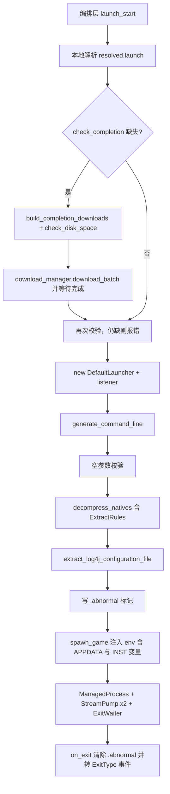

# 启动模块重写方案（以 HMCL 为蓝本，含下载模块衔接分析）

> 本文档先梳理 HMCL 下载模块与启动模块的设计（入口文档 + 源码只读分析），再对照当前 RMCL/RMCCC 启动链路，逐项识别差距，最终给出以「复刻 HMCL 功能行为」为目标的启动模块完整重写方案。报告确认前不修改任何代码。

---

## 一、HMCL 下载模块要点提炼（入口文档）

来源：[`download_下载模块.md`](../Users/chensinuo/Codex/HMCL-main/explain/download_下载模块.md)

### 1.1 模块分层

| 层 | 组件 | 职责 |
|----|------|------|
| 下载提供者层 | `DownloadProvider` / `MojangDownloadProvider` / `BMCLAPIDownloadProvider` / `AutoDownloadProvider` / `DownloadProviderWrapper` | 下载源抽象与镜像切换 |
| 依赖管理层 | `DependencyManager` / `AbstractDependencyManager` / `DefaultDependencyManager` / `DefaultCacheRepository` | 依赖解析与完整性编排 |
| 任务执行层 | `Task` / `FetchTask` / `FileDownloadTask` / `GetTask` / `CacheFileTask` | 异步下载任务 |
| 版本构建 | `GameBuilder` / `DefaultGameBuilder` | 版本安装任务链编排 |

### 1.2 核心机制

1. **URL 注入**：`injectURL()` 将 Mojang 官方 URL 映射为镜像 URL，所有现有 URL 无需修改即可切换下载源。
2. **FetchTask 流程**：ETag 缓存命中 → 遍历 URI 候选列表 → `detectConnection` → `openConnection` → Range 断点续传 → 分块读取 + 边下载边算 SHA1 → 校验 → 移动目标路径 → 缓存。
3. **完整性校验链**：`IntegrityCheckHandler` 链（ZIP 完整性）→ SHA1 `digest.digest()` → 移动到目标 → `cacheFile`（SHA1 缓存）/ `cacheRemoteFile`（ETag 缓存）。
4. **并发控制**：`DownloadProvider.getConcurrency()` 决定并发；`Schedulers` 提供线程池；`progress.bind()` 父子任务进度聚合。
5. **断点续传**：HTTP `Range: bytes={offset}-` + 追加写入。
6. **异常策略**：`DownloadException`（尝试下一个 URI）/ `ChecksumMismatchException`（标记失败）/ `ResponseCodeException`（判断可重试）/ `VersionMismatchException` / `ArtifactMalformedException`（向上抛出）。
7. **与启动的调用关系**：`DefaultDependencyManager.checkGameCompletionAsync(manifest, integrityCheck)` 是启动前必经步骤，并行执行 `GameDownloadTask`（client.jar）、`GameAssetDownloadTask`（asset index + objects）、`GameLibrariesTask`（libraries + natives）、`checkPatchCompletionAsync`（modloader 完整性）。

### 1.3 与当前项目的对照（下载引擎侧）

当前 [`rmccc-download`](../crates/rmccc-download/src/lib.rs) 已具备：多 URL 候选回退（`DownloadItem.candidates`）、重试、SHA1 边下边校验、Range 断点续传、SHA1 缓存仓库（`CacheRepository`，`{data_dir}/cache/objects/{sha1[0:2]}/{sha1}`）、`x-bmclapi-hash` 头利用、`check_disk_space`、`DownloadProvider` trait + Mojang/BMCLAPI 双实现。

与 HMCL 的剩余差距（**非本次重写主目标**，但影响启动模块的完整性检查行为）：
- 无 ETag 条件请求缓存（`cacheRemoteFile`）。
- 无 ZIP 完整性检查 handler。
- 无 `AutoDownloadProvider` 测速选源。

> 结论：下载引擎本体无需重写；启动模块需要**正确编排**这些能力（见第四节 L5）。

---

## 二、HMCL 启动模块要点提炼（文档 + 源码）

来源：[`launch_启动模块.md`](../Users/chensinuo/Codex/HMCL-main/explain/launch_启动模块.md) + [`Launcher.java`](../Users/chensinuo/Codex/HMCL-main/HMCLCore/src/main/java/org/jackhuang/hmcl/launch/Launcher.java:33) + [`DefaultLauncher.java`](../Users/chensinuo/Codex/HMCL-main/HMCLCore/src/main/java/org/jackhuang/hmcl/launch/DefaultLauncher.java:51) + [`LaunchOptions.java`](../Users/chensinuo/Codex/HMCL-main/HMCLCore/src/main/java/org/jackhuang/hmcl/game/LaunchOptions.java:31)

### 2.1 类层次

```
Launcher (抽象)                    # makeLaunchScript() / launch()
 └─ DefaultLauncher                 # 命令行生成、native 解压、进程创建
     └─ HMCLGameLauncher            # options.txt、lwjgl-unsafe-agent、崩溃分析挂钩
```

配套：`ManagedProcess`（进程包装 + 行缓冲）、`ProcessListener`（onLog/onExit 回调）、`StreamPump`（stdout/stderr 流泵）、`ExitWaiter`（等待退出 + 关联线程 + postExitCommand）、`LaunchOptions`（Builder 值对象）、`CommandBuilder`（参数去重）、`Arguments`（版本 JSON 参数解析）。

### 2.2 `generateCommandLine()` 20 步 Pipeline（[`DefaultLauncher.java:69`](../Users/chensinuo/Codex/HMCL-main/HMCLCore/src/main/java/org/jackhuang/hmcl/launch/DefaultLauncher.java:69)）

1. 进程优先级（`nice -n` / Windows `start /high`）
2. wrapper 命令
3. Java 可执行路径
4. overrideJavaArguments（最高优先级 JVM 覆盖）
5. 内存参数（`-Xmx/-Xms/-XX:MetaspaceSize`，min ≤ max 才加 `-Xms`）
6. `javaArguments`（用户 JVM 参数）
7. 编码：`-Dfile.encoding` + Java<19 用 `sun.stdout/stderr.encoding`，≥19 用 `stdout/stderr.encoding`
8. log4j RCE 修复：`useCodebaseOnly/trustURLCodebase/formatMsgNoLookups`
9. `-Dlog4j.configurationFile`（仅用 log4j 且非 debug 关闭时）
10. 自动 JVM 参数（`noGeneratedJVMArgs` 为否时）：`-Dminecraft.client.jar`（真实路径）、macOS `-Xdock`、非 Windows `-Duser.home`、代理（`noneMatch` 探测 → useSystemProxies / http / socks）
11. 优化参数（`noGeneratedOptimizingJVMArgs` 为否时）：Unlock 实验/诊断、G1GC 全家桶、JIT（MaxInlineLevel/ReservedCodeCacheSize/NonNMethodCodeHeapSize 等）、32 位 `-Xss1m`
12. `javaVersion==16 → --illegal-access=permit`；`24/25 → --sun-misc-unsafe-memory-access=allow`
13. FML 修复参数
14. classpath（`repository.getClasspath` + client.jar，`removeIf` Cleanroom 冲突项）
15. 模板变量替换（`getConfigurations()`，含 `${classpath}/${game_assets}/${natives_directory}` 等）
16. 版本 JSON `arguments.jvm`（识别 `-Djava.library.path=${natives_directory}/sub` 子目录）
17. `authInfo.getLaunchArguments().jvm()` + javaAgents（`-javaagent:`）
18. mainClass + `minecraftArguments`（旧格式）
19. `arguments.game`（新格式，带 `features`）+ `authInfo.getLaunchArguments().game()` + quickPlay/fullscreen/graphicsBackend + 用户 gameArguments
20. `removeIf(getForbiddens())`（如 Java≥9 禁 `-Xincgc`）

### 2.3 `launch()` 流程（[`DefaultLauncher.java:565`](../Users/chensinuo/Codex/HMCL-main/HMCLCore/src/main/java/org/jackhuang/hmcl/launch/DefaultLauncher.java:565)）

```
generateCommandLine → 空参数校验 → tempNativeFolder 符号链接（非 ASCII 路径时）
→ decompressNatives(javaNativeFolder)   # cleanDirectory + ExtractRules 过滤 + replaceExistentFile=false
→ extractLog4jConfigurationFile()       # 1.7/1.12 × normal/debug 四选一
→ preLaunchCommand
→ ProcessBuilder.start()（env: APPDATA + getEnvVars()）
→ new ManagedProcess + startMonitors（StreamPump×2 + ExitWaiter → ProcessListener）
```

### 2.4 `getEnvVars()`（[`DefaultLauncher.java:619`](../Users/chensinuo/Codex/HMCL-main/HMCLCore/src/main/java/org/jackhuang/hmcl/launch/DefaultLauncher.java:619)）

`INST_NAME / INST_ID / INST_DIR / INST_MC_DIR / INST_JAVA` + 渲染器（`GALLIUM_DRIVER / VK_ICD_FILENAMES / __GLX_VENDOR_LIBRARY_NAME` 等）+ modloader 标记（`INST_FORGE / INST_NEOFORGE / INST_FABRIC / INST_OPTIFINE / INST_QUILT / INST_LITELOADER / INST_LEGACYFABRIC / INST_CLEANROOM`）+ 用户自定义环境变量。

### 2.5 启动脚本（[`DefaultLauncher.java:714`](../Users/chensinuo/Codex/HMCL-main/HMCLCore/src/main/java/org/jackhuang/hmcl/launch/DefaultLauncher.java:714)）

`.bat`（系统原生编码）/ `.ps1`（UTF-8 BOM）/ `.sh/.command/.bash`（UTF-8）。流程与 `launch()` 一致但输出为文件；Windows 命令超 32767 抛 `CommandTooLongException`。

### 2.6 崩溃处理

退出码检测 + `.abnormal` 标记文件（`HMCLGameRepository.markInstanceLaunchedAbnormally`）+ `CrashReportAnalyzer` 解析 `crash-reports/`。

---

## 三、当前项目启动链路现状

### 3.1 代码分布

- **引擎层** [`crates/rmccc-launch`](../crates/rmccc-launch/src/lib.rs)：`java.rs`（Java 检测）、`managed.rs`（tokio `ManagedProcess` + 行收集）、`natives.rs`（native 解压）、`process.rs`（response file + `spawn_game` + `CommandBuilder` + `LaunchArgBuilder::jvm_args/game_args` + `build_game_env`）。
- **编排层** [`src-tauri/src/commands/launch.rs`](../src-tauri/src/commands/launch.rs:340)（`launch_start`）与 [`src-cli/src/commands/launch.rs`](../src-cli/src/commands/launch.rs:6)。
- **辅助**：完整性检查 [`completion.rs`](../crates/rmccc-version/src/completion.rs:40)、目录布局 [`file_layout.rs`](../crates/rmccc-version/src/file_layout.rs:1)、模板变量 [`arguments.rs`](../crates/rmccc-version/src/arguments.rs:60)、DI 容器 [`rmccc-core/src/lib.rs`](../crates/rmccc-core/src/lib.rs:31)。

### 3.2 当前 `launch_start` 七阶段

```
Phase1-2 resolve_launch_profile（本地仓库 get_resolved）→ validate_launch_readiness（仅检查 game_dir + client.jar）→ ensure_game_dirs
Phase3  detect_java（自定义路径或 find_java）
Phase4  build_classpath（libraries::collect_classpath + client.jar）
Phase5  resolve_auth_session（登录或离线回退）
Phase6  build_launch_args（版本 JSON JVM/game 参数 + response file）
Phase7  spawn_game（extra_env = None）→ ManagedProcess + monitors → 删除 response file → 事件转发
```

---

## 四、差距与问题清单

| # | 严重度 | 问题 | 说明 |
|---|--------|------|------|
| L1 | 严重 | **启动流程未解压 natives** | `launch_start` 从不调用 [`decompress_natives`](../crates/rmccc-launch/src/natives.rs:44)；HMCL `launch()` 必做 |
| L2 | 严重 | **环境变量未注入** | [`spawn_game`](../crates/rmccc-launch/src/process.rs:81) 传 `extra_env=None`，[`build_game_env`](../crates/rmccc-launch/src/process.rs:631) 结果被丢弃；`INST_*`、Windows `APPDATA` 全部缺失 |
| L3 | 中 | **natives 解压逻辑不完整** | 未按 `library.getExtract().shouldExtract()` 过滤；未先 clean 目录；未识别 `-Djava.library.path=${natives_directory}/sub` 子目录；无非 ASCII 路径临时目录 |
| L4 | 中 | **log4j2.xml 未提取** | 无 `-Dlog4j.configurationFile` 注入、无 log4j2.xml 资源（HMCL 4 种：1.7/1.12 × normal/debug） |
| L5 | 中 | **启动前无完整性检查** | 仅 `validate_launch_readiness`（game_dir + client.jar）；不检查/下载缺失 libraries/assets/natives。HMCL 启动前必跑 `checkGameCompletionAsync`。能力已在 [`completion.rs`](../crates/rmccc-version/src/completion.rs:40) + [`instance_repair`](../src-tauri/src/commands/instance.rs:211) 就绪，但未接入启动链路 |
| L6 | 中 | **崩溃检测缺失** | 无 `.abnormal` 标记；`ManagedProcess` 仅返回 exit_code，无 `ExitType`（正常/异常）分类 |
| L7 | 中 | **无启动脚本生成** | 无 `makeLaunchScript`（.bat/.ps1/.sh） |
| L8 | 中 | **编排逻辑在 IPC 层，与 HMCL 结构不符** | 无 `Launcher`/`DefaultLauncher`/`LaunchOptions` 抽象；无法复用、难以测试 |
| L9 | 低 | **ManagedProcess 回调简陋** | 轮询 `drain_lines` 代替 `onLog(line,isStderr)` 回调；不区分 stdout/stderr；无 `ProcessListener` 契约 |
| L10 | 低 | **模板变量与 features 不全** | `game_assets` 未提供（以 `assets_root` 代替）；`features` 传空 `HashMap`，未计算 `has_custom_resolution` |
| L11 | 低 | **缺少若干 LaunchOptions 能力** | 无 process priority / wrapper / javaAgents / preLaunchCommand / postExitCommand / nativeGLFW / OpenAL 开关；[`Profile`](../crates/rmccc-profile/src/lib.rs:11) 无对应字段 |
| L12 | 低 | **`-Dminecraft.client.jar` 为空占位** | [`LaunchArgBuilder::jvm_args`](../crates/rmccc-launch/src/process.rs:430) 中 `add_default("-Dminecraft.client.jar=", "")` 无真实路径 |
| L13 | 低 | **缺 `-Duser.home` / 代理注入** | 未复刻 HMCL 对应步骤 |
| L14 | 低 | **路径解析重复** | [`natives.rs::resolve_library_path`](../crates/rmccc-launch/src/natives.rs:153) 与 [`file_layout::library_file`](../crates/rmccc-version/src/file_layout.rs:72) / `libraries::make_library_path` 重复 |
| L15 | 低 | **kill 职责分散** | `launch_kill` 用进程组 SIGKILL，与 [`ManagedProcess::kill`](../crates/rmccc-launch/src/managed.rs:109) 职责重复 |

---

## 五、改进方案设计（与 HMCL 同构）

### 5.1 目标模块结构

```
crates/rmccc-launch/
├── lib.rs                  # 模块声明 + re-export
├── options.rs              # LaunchOptions（Builder）+ ProcessPriority + Renderer 占位  ← 新
├── launcher.rs             # Launcher trait：launch()/make_launch_script()            ← 新
├── default_launcher.rs     # DefaultLauncher：generate_command_line/get_configurations/
│                           #   get_features/get_env_vars/launch/make_launch_script    ← 新
├── command.rs              # Command { args, java_native_folder, temp_native_folder } ← 新
├── process_listener.rs     # ProcessListener trait + ExitType                          ← 新
├── managed.rs              # 重构：StreamPump(stdout/stderr) + ExitWaiter + on_log/on_exit
├── natives.rs              # 重构：ExtractRules 过滤 + clean + subdir natives + 复用 file_layout
├── log4j.rs                # extract_log4j_configuration_file（内嵌资源）               ← 新
├── java.rs                 # 保留（JavaInstallation → JavaRuntime 语义）
└── process.rs              # 保留 CommandBuilder + response file + spawn_game（增强 env 注入）
```

### 5.2 关键抽象

```rust
/// 对齐 HMCL Launcher 抽象基类
pub trait Launcher {
    fn launch(self: Arc<Self>) -> Result<Arc<ManagedProcess>, LaunchError>;
    fn make_launch_script(&self, path: &Path) -> Result<(), LaunchError>;
}

/// 对齐 HMCL DefaultLauncher
pub struct DefaultLauncher {
    repository: Arc<RwLock<DefaultGameRepository>>, // 复用已注入的本地仓库
    manifest: ResolvedVersion,                      // resolved.launch（双视图）
    auth: AuthInfo,
    options: LaunchOptions,
    listener: Option<Arc<dyn ProcessListener>>,
}

/// 对齐 HMCL LaunchOptions（Builder）
pub struct LaunchOptions {
    pub java: JavaInstallation,
    pub game_dir: PathBuf,
    pub version_name: Option<String>,
    pub version_type: Option<String>,
    pub max_memory: Option<u32>,
    pub min_memory: Option<u32>,
    pub metaspace: Option<u32>,
    pub jvm_args: Vec<String>,     // 用户 JVM
    pub game_args: Vec<String>,    // 用户 game
    pub java_agents: Vec<String>,
    pub env_vars: HashMap<String, String>,
    pub process_priority: ProcessPriority,
    pub wrapper: Option<String>,
    pub width/height/fullscreen: ...
    pub pre_launch_command: Option<String>,
    pub post_exit_command: Option<String>,
    pub use_native_glfw/openal: bool,
    pub use_custom_natives: bool,
    pub no_generated_jvm_args: bool,
}

/// 对齐 HMCL ProcessListener
pub trait ProcessListener: Send + Sync {
    fn set_process(&self, _p: &ManagedProcess) {}
    fn on_log(&self, line: String, is_stderr: bool);
    fn on_exit(&self, exit_code: i32, exit_type: ExitType);
}
pub enum ExitType { Normal, Abnormal }
```

### 5.3 `DefaultLauncher::generate_command_line()` 复刻范围

按 HMCL 20 步 Pipeline 重排现有 [`LaunchArgBuilder`](../crates/rmccc-launch/src/process.rs:418)，补足：
- `-Dminecraft.client.jar=` 注入真实路径（`file_layout::instance_jar(game_dir, jar_id)`）。
- `-Dlog4j.configurationFile=`（仅 log4j 版本，非 debug 关闭时）。
- 非 Windows `-Duser.home=`（game_dir 的父目录）。
- 代理注入（先 `noneMatch` 探测，默认 `useSystemProxies=true`）。
- `features = { has_custom_resolution: width>0 && height>0 }`。
- 识别 `-Djava.library.path=${natives_directory}/sub` 子目录并作为解压目标。
- 保留 response file 机制（token 不泄漏，P1-03 不回退）。
- `removeIf` 禁用参数（Java≥9 禁 `-Xincgc`）。

### 5.4 `launch()` 完整流程（编排层职责划分）



> 完整性检查与下载编排放编排层（IPC/CLI），对齐 HMCL「`LauncherHelper` 先 `checkGameCompletionAsync` 再 `new DefaultLauncher`」；`DefaultLauncher` 保持纯净。

### 5.5 崩溃标记

在编排层（或扩展 repository）实现 `mark_instance_launched_abnormally(game_dir, id, abnormal: bool)`：启动时写 `{instance_root}/.abnormal`，正常退出（`ExitType::Normal`）清除；异常退出保留并向前端发 `LAUNCH_EXITED` 的 `exit_type` 字段。

### 5.6 向后兼容

- 保留现有 `spawn_game` / `CommandBuilder` / `build_response_file` 公共 API 与测试。
- `LaunchArgBuilder::jvm_args/game_args` 保留（内部改由 `DefaultLauncher` 调用），签名不变。
- [`Profile`](../crates/rmccc-profile/src/lib.rs:11) 新增字段全部 `#[serde(default)]` + `Default`，旧 JSON 可无损加载。
- CLI [`launch_run`](../src-cli/src/commands/launch.rs:12) 与 Tauri [`launch_start`](../src-tauri/src/commands/launch.rs:340) 调用路径保持不变，仅内部实现替换。

---

## 六、分步实施计划（供 Code 模式执行）

1. **LaunchOptions 与 ProcessPriority**：新增 [`options.rs`](../crates/rmccc-launch/src/options.rs)，Builder 模式；`Profile` 扩展可选字段（全 `#[serde(default)]`）。
2. **ProcessListener 与 ExitType**：新增 [`process_listener.rs`](../crates/rmccc-launch/src/process_listener.rs)；重构 [`managed.rs`](../crates/rmccc-launch/src/managed.rs) 为 StreamPump(stdout)+StreamPump(stderr)+ExitWaiter，注册 `on_log(line,is_stderr)/on_exit(code,ExitType)`。
3. **natives 重构**：`ExtractRules` 过滤（复用 [`types.rs::ExtractRules`](../crates/rmccc-version/src/types.rs:342)）、先 clean 目录、`-Djava.library.path` 子目录识别、复用 [`file_layout`](../crates/rmccc-version/src/file_layout.rs:1) 消除 L14 重复。
4. **log4j 资源与提取**：新增 [`log4j.rs`](../crates/rmccc-launch/src/log4j.rs)，内嵌 1.7/1.12 × normal/debug 四份 xml，按版本提取到 `{instance_root}/log4j2.xml`。
5. **DefaultLauncher 骨架**：新增 [`launcher.rs`](../crates/rmccc-launch/src/launcher.rs) trait + [`default_launcher.rs`](../crates/rmccc-launch/src/default_launcher.rs)，实现 `get_configurations/get_features/get_env_vars/generate_command_line`（20 步 Pipeline + 模板变量补全 + features）。
6. **DefaultLauncher::launch()**：完整流程（解压 natives → log4j → preLaunchCommand → spawn 注入 env → monitors），返回 `Arc<ManagedProcess>`。
7. **make_launch_script()**：.bat/.ps1/.sh/.command/.bash 生成 + 编码处理（GBK / UTF-8 BOM）+ 超长命令校验。
8. **启动前完整性检查编排**：`launch_start` 插入 `completion::check_completion` → `build_completion_downloads` → `download_manager.download_batch` → `check_disk_space` → 二次校验。
9. **IPC/CLI 编排层改造**：`launch.rs`（Tauri）改用 `DefaultLauncher` + 自定义 `ProcessListener` 转发 `LAUNCH_STARTED/LAUNCH_OUTPUT/LAUNCH_EXITED`（含 `exit_type`）；补 `.abnormal` 标记；保留 response file 安全删除；`launch_kill` 收敛到 `ManagedProcess::kill` 或进程组。
10. **测试与验证**：新增单元测试（命令行 Pipeline / natives ExtractRules / log4j 提取 / 脚本生成 / 完整性编排）；跑 `cargo build` + `cargo test --workspace`，CLI 端到端启动 vanilla 实例验证正常与异常场景。

---

## 七、风险说明

| 风险 | 说明 | 缓解 |
|------|------|------|
| 大范围改动破坏现有启动路径 | 涉及引擎层 + 编排层 + Profile 模型 | 保持公共 API 签名不变；测试先行；分步提交 |
| token 泄漏（P1-03） | 脚本生成/命令行重构若绕过 response file 会回退泄漏 | 启动仍走 response file；脚本生成仅面向非 token 场景或同样用临时文件 |
| 平台差异 | Windows 编码/进程组、macOS dock、Linux natives | 平台 cfg 分支 + 现有测试覆盖 |
| Profile JSON 兼容 | 新增字段导致旧文件解析失败 | 全部 `#[serde(default)]` |
| 体积红线 <10MB | log4j 资源极小的 xml | 无新增重依赖 |
| 完整性下载在弱网下的行为 | 启动被下载阻塞 | 失败策略：报错并引导 instance_repair，不静默继续 |

---

## 附：验证方式

1. `cargo test --workspace`（含新增启动/脚本/完整性测试）。
2. `cargo build`（Tauri + CLI）。
3. `rmcli instance create <vanilla> && rmcli launch run <id>`：正常启动、退出码正确、`natives-{platform}` 生成、log4j2.xml 提取。
4. 手工删除某 library/assets 后启动：应触发下载补齐；断网时给出明确错误而非静默失败。
5. 异常终止（kill 进程）后：`.abnormal` 标记存在、`LAUNCH_EXITED` 带 `exit_type=abnormal`。
